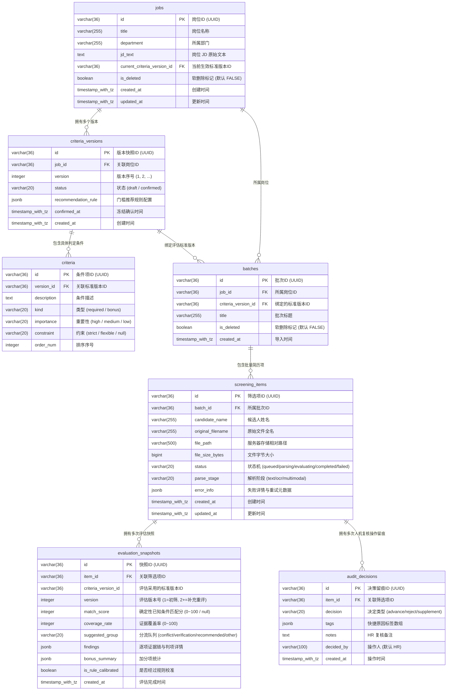
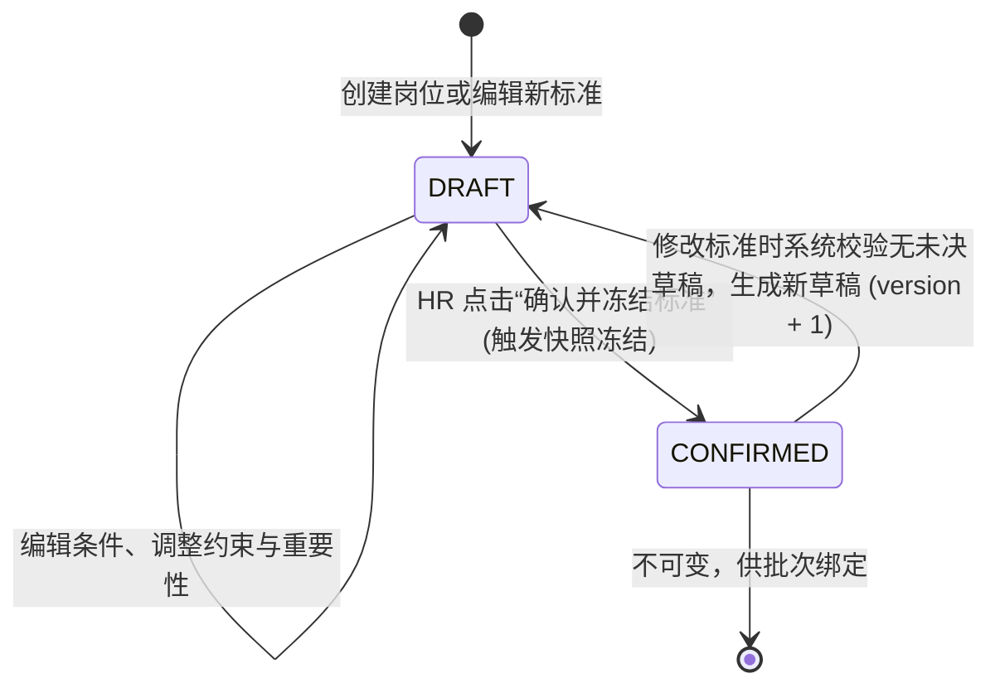
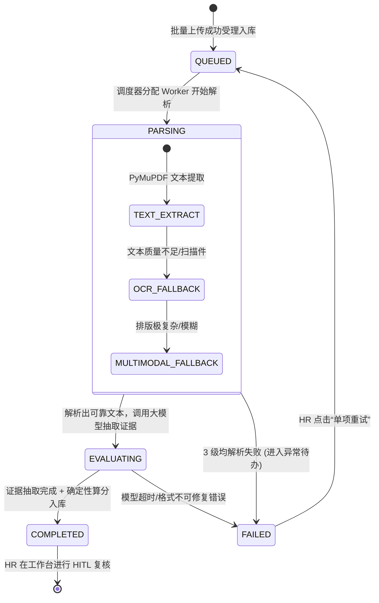

# DB-001 简历智能筛选助手：数据库设计规范

| 属性 | 内容 |
|---|---|
| 文档版本 | 1.1 (已应用严审修正：增加单草稿约束、软删除保护与审计隔离) |
| 更新日期 | 2026-11-04 |
| 状态 | 物理实现基准（已对齐 Alembic 迁移与 SQLAlchemy 实体） |
| 依据基准 | [PRD-001 简历筛选助手 MVP](../prd/PRD-001-resume-screening-mvp.md)、[SPEC-001 Demo 对象与交互规格](../prd/SPEC-001-demo-interaction-model.md) |
| 适用目标 | PostgreSQL 16 (生产/容器化) / SQLite 3 (本地极速开发) |

---

## 1. 架构理念与设计原则

数据库架构遵循 **Schema Architect 五层模型** 与 **防腐设计**，针对智能筛选业务建立以下核心防线：

1. **事实、状态与推断分离（Facts vs State vs Inferences）**：
   - **业务事实（Facts）**：原始 JD、上传的原件文件元数据、HR 人工录入的复核决定；
   - **运行状态（State）**：批次进度、单项解析阶段、重试次数与错误原因；
   - **AI 推断（Inferences）**：大模型抽取的证据链（引文、页码、判定）与确定性派生分。推断数据持久化为独立快照，严禁回写污染原始输入。
2. **不可变版本快照机制（Immutable Criteria & Snapshots）**：
   - 岗位标准一旦确认为 `confirmed`，该记录及其下属条件全量冻结，不可直接物理修改或物理删除。后续调整自动派生新版本号（v2, v3...）；
   - **单一草稿互斥保证**：通过部分唯一索引，强制同一岗位在同一时刻只能存在一份 `status = 'draft'` 的编辑中草稿；
   - 批次导入严格外键绑定特定标准版本，确保历史批次的评估基线绝对一致、可复核。
3. **版本化评估与防反向注入（Evaluation Snapshots & Versioning）**：
   - 候选人的单次评估结果存入 `evaluation_snapshots`，初筛为版本 1；
   - HR 电话追问录入定向补充说明后，触发增量重评生成版本 2 快照，旧版快照与历史人工决定完整保留，支持前后对比。
4. **审计与合规留痕保护（Audit Trail & Soft Delete）**：
   - HR 的推进、暂不推进、待补充信息等每一次操作均追加写入 `audit_decisions`；
   - `jobs` 与 `batches` 强制启用 `is_deleted` 逻辑软删除，严禁物理级联粉碎法律与招聘审计记录。

---

## 2. 全局实体关系图 (Entity-Relationship Diagram)



---

## 3. 核心生命周期与状态机契约

### 3.1 岗位标准生命周期 (Criteria Version FSM)


### 3.2 简历处理任务流水线状态机 (Screening Item FSM)


---

## 4. 详细数据表规范定义

### 4.1 岗位表 (`jobs`)
保存企业招聘的岗位元数据与当前生效的标准版本指向。

| 字段名 | 类型 | 允许空 | 默认值 | 约束 / 索引 | 业务含义与说明 |
| :--- | :--- | :---: | :--- | :--- | :--- |
| `id` | VARCHAR(36) | 否 | UUIDv4 | PRIMARY KEY | 岗位全局唯一主键 |
| `title` | VARCHAR(255) | 否 | - | INDEX | 岗位名称（如：“资深后端开发专家”） |
| `department` | VARCHAR(255) | 否 | - | - | 所属部门（如：“基础架构部”） |
| `jd_text` | TEXT | 否 | - | - | 原始招聘需求 JD 正文（用于 AI 解析提炼基准） |
| `current_criteria_version_id` | VARCHAR(36) | 是 | NULL | FK(`criteria_versions.id`), INDEX | 当前已确认生效的标准版本 ID |
| `is_deleted` | BOOLEAN | 否 | FALSE | INDEX | 逻辑软删除标记（防止误删导致审计丢失） |
| `created_at` | TIMESTAMPTZ | 否 | NOW() | - | 岗位创建时间 |
| `updated_at` | TIMESTAMPTZ | 否 | NOW() | - | 岗位最后修改时间 |

---

### 4.2 岗位标准版本快照表 (`criteria_versions`)
管理版本化标准。状态为 `confirmed` 后成为只读不可变快照。

| 字段名 | 类型 | 允许空 | 默认值 | 约束 / 索引 | 业务含义与说明 |
| :--- | :--- | :---: | :--- | :--- | :--- |
| `id` | VARCHAR(36) | 否 | UUIDv4 | PRIMARY KEY | 标准版本快照唯一主键 |
| `job_id` | VARCHAR(36) | 否 | - | FK (`jobs.id`), INDEX | 所属岗位外键 |
| `version` | INTEGER | 否 | 1 | UNIQUE(`job_id`, `version`) | 该岗位下的递增版本序号 (1, 2, 3...) |
| `status` | VARCHAR(20) | 否 | 'draft' | INDEX | 状态枚举：`draft` (草稿) / `confirmed` (已确认生效) |
| `recommendation_rule` | JSONB | 否 | 见下文 | - | 门槛校准参数，结构：`{"min_match_score": 70, "min_coverage_rate": 60, "is_calibrated": false}` |
| `confirmed_at` | TIMESTAMPTZ | 是 | NULL | - | 确认冻结时间（草稿状态为 NULL） |
| `created_at` | TIMESTAMPTZ | 否 | NOW() | - | 版本草稿创建时间 |

> [!IMPORTANT]
> **部分唯一索引防并发保证**：
> 数据库层面强制执行：`CREATE UNIQUE INDEX uq_job_active_draft ON criteria_versions (job_id) WHERE status = 'draft';`，确保同一岗位在任意时刻物理上只能存在至多一份未冻结的草稿版本。

---

### 4.3 标准条件明细表 (`criteria`)
每条标准拆解后的具体评估指标条目。

| 字段名 | 类型 | 允许空 | 默认值 | 约束 / 索引 | 业务含义与说明 |
| :--- | :--- | :---: | :--- | :--- | :--- |
| `id` | VARCHAR(36) | 否 | UUIDv4 | PRIMARY KEY | 条件唯一主键 |
| `version_id` | VARCHAR(36) | 否 | - | FK (`criteria_versions.id`), INDEX | 所属标准版本外键（级联删除草稿） |
| `description` | TEXT | 否 | - | - | 条件业务描述（如：“5年以上后端开发经验”） |
| `kind` | VARCHAR(20) | 否 | - | - | 条件类别枚举：`required` (必要条件) / `bonus` (加分项) |
| `importance` | VARCHAR(20) | 否 | - | - | 重要性枚举：`high` (权重3) / `medium` (权重2) / `low` (权重1) |
| `constraint` | VARCHAR(20) | 是 | NULL | - | 约束约束枚举：`strict` (不可放宽红线) / `flexible` (可酌情) / `null` (加分项无约束) |
| `order_num` | INTEGER | 否 | 0 | - | 前端展示排列顺序号 |

---

### 4.4 简历导入批次表 (`batches`)
单次批量导入的主记录（单批最多 50 份）。

| 字段名 | 类型 | 允许空 | 默认值 | 约束 / 索引 | 业务含义与说明 |
| :--- | :--- | :---: | :--- | :--- | :--- |
| `id` | VARCHAR(36) | 否 | UUIDv4 | PRIMARY KEY | 批次全局唯一主键 |
| `job_id` | VARCHAR(36) | 否 | - | FK (`jobs.id`), INDEX | 所属岗位外键 |
| `criteria_version_id`| VARCHAR(36) | 否 | - | FK (`criteria_versions.id`) | 导入时锁定的不可变标准版本外键 |
| `title` | VARCHAR(255) | 否 | - | - | 批次标题（默认按日期+批次号命名） |
| `is_deleted` | BOOLEAN | 否 | FALSE | INDEX | 逻辑软删除标记 |
| `created_at` | TIMESTAMPTZ | 否 | NOW() | INDEX | 批次创建与上传提交时间 |

---

### 4.5 候选人筛选项表 (`screening_items`)
记录单份 PDF 简历的处理全生命周期与文件物理路径。

| 字段名 | 类型 | 允许空 | 默认值 | 约束 / 索引 | 业务含义与说明 |
| :--- | :--- | :---: | :--- | :--- | :--- |
| `id` | VARCHAR(36) | 否 | UUIDv4 | PRIMARY KEY | 筛选项全局唯一主键 |
| `batch_id` | VARCHAR(36) | 否 | - | FK (`batches.id`), INDEX | 所属导入批次外键 |
| `candidate_name` | VARCHAR(255) | 是 | NULL | INDEX | 解析出的候选人姓名（解析前为 NULL） |
| `original_filename` | VARCHAR(500) | 否 | - | - | 用户上传时的原始文件名（如 `张三_Java高级.pdf`） |
| `file_path` | VARCHAR(500) | 否 | - | - | 服务器本地存储或对象存储的实际相对路径 |
| `file_size_bytes` | BIGINT | 否 | 0 | - | 文件大小（字节） |
| `status` | VARCHAR(20) | 否 | 'queued' | INDEX | 状态机枚举：`queued` / `parsing` / `evaluating` / `completed` / `failed` |
| `parse_stage` | VARCHAR(20) | 否 | 'text' | - | 当前解析阶段枚举：`text` (文本提取) / `ocr` (OCR识别) / `multimodal` (视觉模型) |
| `error_info` | JSONB | 是 | NULL | - | 异常待办元数据，结构：`{"code": "ERR_CORRUPTED_PDF", "message": "文件头损坏", "retryable": true}` |
| `created_at` | TIMESTAMPTZ | 否 | NOW() | - | 创建入库时间 |
| `updated_at` | TIMESTAMPTZ | 否 | NOW() | INDEX | 最后状态更新时间 |

---

### 4.6 评估快照表 (`evaluation_snapshots`)
存放确定性打分、分流建议与全部证据项详情。单候选人支持多次评估版本。

| 字段名 | 类型 | 允许空 | 默认值 | 约束 / 索引 | 业务含义与说明 |
| :--- | :--- | :---: | :--- | :--- | :--- |
| `id` | VARCHAR(36) | 否 | UUIDv4 | PRIMARY KEY | 快照全局唯一主键 |
| `item_id` | VARCHAR(36) | 否 | - | FK (`screening_items.id`), INDEX | 关联筛选项外键 |
| `criteria_version_id`| VARCHAR(36) | 否 | - | - | 实际评估采用的标准版本快照 ID |
| `version` | INTEGER | 否 | 1 | INDEX | 评估版本号（1=初评，2+=电话核实补充材料后重评） |
| `match_score` | INTEGER | 是 | NULL | INDEX | 已知条件匹配分（0~100；必要条件全未知时为 NULL） |
| `coverage_rate` | INTEGER | 否 | 0 | INDEX | 证据覆盖率（0~100%） |
| `suggested_group` | VARCHAR(20) | 否 | 'other' | INDEX | 系统分流队列：`conflict` / `verification` / `recommended` / `other` |
| `findings` | JSONB | 否 | '[]' | - | 结构化判定详情数组（包含各项条件判定、原文引用与 PDF 页码，详见下文定义） |
| `bonus_summary` | JSONB | 否 | 见下文 | - | 加分项统计：`{"met": 1, "total": 2}` |
| `is_rule_calibrated`| BOOLEAN | 否 | FALSE | - | 该评估是否经过岗位门槛校准 |
| `created_at` | TIMESTAMPTZ | 否 | NOW() | - | 评估快照生成落库时间 |

#### `findings` JSON 存储结构规范（支持原生与定向人工证据）：
```json
[
  {
    "criterion_id": "c1a2b3c4-...",
    "verdict": "met",
    "reason": "候选人有6年服务端研发经验，曾主导微服务重构",
    "evidence_ids": ["ev_1"],
    "evidences": [
      {
        "id": "ev_1",
        "page": 1,
        "quote": "2018.07-至今 某某科技有限公司 高级后端工程师（工作年限：6年）",
        "method": "text"
      }
    ]
  },
  {
    "criterion_id": "c2b3c4d5-...",
    "verdict": "met",
    "reason": "HR 电话沟通核实确认具备高并发拆分经验",
    "evidence_ids": ["ev_manual_01"],
    "evidences": [
      {
        "id": "ev_manual_01",
        "page": null,
        "quote": "HR 电话追问记录：主导过日活 500 万微服务架构改造",
        "method": "manual"
      }
    ]
  }
]
```

---

### 4.7 人机复核决策审计表 (`audit_decisions`)
HR 人工复核所有操作留痕，严格保护候选人终审权。

| 字段名 | 类型 | 允许空 | 默认值 | 约束 / 索引 | 业务含义与说明 |
| :--- | :--- | :---: | :--- | :--- | :--- |
| `id` | VARCHAR(36) | 否 | UUIDv4 | PRIMARY KEY | 决策记录唯一主键 |
| `item_id` | VARCHAR(36) | 否 | - | FK (`screening_items.id`), INDEX | 关联筛选项外键 |
| `decision` | VARCHAR(20) | 否 | - | INDEX | HR 决策枚举：`advance` (推进沟通) / `reject` (暂不推进) / `supplement` (待补充信息) |
| `tags` | JSONB | 否 | '[]' | - | 快捷标签数组（如：`["年限不足", "学历硬伤", "技术栈极度匹配"]`） |
| `notes` | TEXT | 否 | '' | - | HR 手工填写的个性化复核备注与沟通备忘 |
| `decided_by` | VARCHAR(100) | 否 | 'HR' | - | 决策操作人身份标识 |
| `created_at` | TIMESTAMPTZ | 否 | NOW() | INDEX | 决策发生时间（每次修改产生一条新记录） |

---

## 5. 关键索引与性能设计

为保障批次工作台（批量筛选、队列过滤、高频排序）以及详情页的毫秒级响应，规划以下物理索引：

```sql
-- 1. 唯一草稿保护索引 (单岗位仅限一份 draft)
CREATE UNIQUE INDEX uq_job_active_draft ON criteria_versions (job_id) WHERE status = 'draft';

-- 2. 筛选项与批次查询索引 (支持软删除与状态组合过滤)
CREATE INDEX idx_screening_items_batch_status ON screening_items (batch_id, status);

-- 3. 评估快照版本与分流队列联合索引（用于工作台队列聚合展示）
CREATE INDEX idx_evaluation_snapshots_item_version ON evaluation_snapshots (item_id, version DESC);
CREATE INDEX idx_evaluation_snapshots_group_score ON evaluation_snapshots (suggested_group, match_score DESC);

-- 4. 审计留痕检索索引
CREATE INDEX idx_audit_decisions_item_created ON audit_decisions (item_id, created_at DESC);

-- 5. 岗位与版本外键索引
CREATE INDEX idx_jobs_deleted ON jobs (is_deleted);
CREATE INDEX idx_batches_deleted ON batches (is_deleted);
CREATE INDEX idx_criteria_versions_job_status ON criteria_versions (job_id, status);
CREATE INDEX idx_criteria_version_order ON criteria (version_id, order_num);
```
