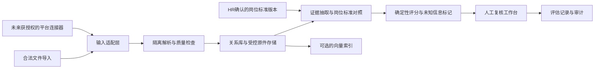

# 两个开源项目：源码审查与工程选型报告

日期：2026-10-29。范围：用户提供的本地 Git 快照。状态：静态审查＋离线原函数逻辑复现，未作线上平台测试或生产认证。

采用技能：petl-code-reviewer、petl-software-architect，并沿用本会话已读取的 petl-security-engineer 原则。建议由技术负责人负责整改，招聘负责人批准岗位标准，安全/法务复核数据及平台接入。

## 1. 结论与选型

**LLM-Agent-Resume 更适合作为离线筛选原型的结构参考；boss-zhipin-mcp 更适合作为平台交互的研究样本。两个项目目前都不宜直接部署为企业级招聘筛选系统，也不能提供“不封号”保证。**

不建议把两个项目直接拼接上线：前者缺少可靠业务存储、身份鉴权及完整人审闭环，后者尚未实现你的核心入口——已有私信用户的简历增量处理，而且存在具体评分与状态错误。

| 维度 | LLM-Agent-Resume | boss-zhipin-mcp |
|---|---|---|
| 本地 HEAD | `7524b74b62160444c37fae07646a6a8c7a690595` | `06a1a7d804aa80131a066bddc1879ac4bc72f841` |
| 本地最新提交时间 | 2026-06-22 | 2026-03-31 |
| 核心定位 | 上传简历后的解析、检索、过滤、评分与报告 | 招聘者“找人才”页面搜索、查看、分享链接及发起沟通 |
| 技术 | FastAPI、LangChain、Chroma/Milvus、pypdf、原生 Web UI | FastMCP stdio、Playwright CDP、页面 DOM/响应监听、JSON 文件 |
| AI 实际作用 | 提取结构化字段、解析查询、生成分析；分数主要是规则计算 | 内置评估以关键词加减分为主；深度 AI 评估交给调用它的助手 |
| 私信收件队列 | 未实现 | 未发现会话列表读取、私信增量游标、附件入库闭环 |
| 测试与交付 | 有较丰富 tests 目录、Dockerfile；无锁文件与本地 CI 配置 | 本地未发现测试目录、锁文件或 CI 配置 |
| 许可 | 本地未找到 LICENSE 或明确许可文本 | README 写 MIT 并链接 LICENSE，但本地未包含该文件 |
| 建议成熟度 | 演示/原型级；可参考模块划分 | 个人自动化工具级；生产复用条件尚不满足 |

提交日期仅代表本地快照，不能证明远端当前活跃度；本次没有联网更新。源码公开不等于任意商用授权。两个项目都需补核许可及版权范围，尤其不能将 README 徽章替代完整许可核验。

## 2. 已完成的验证与限制

- 阅读两项目 README、依赖、核心入口、存储、筛选评分、模型调用、页面操作、凭证处理和相关测试。
- 检查仓库根目录：均无 `.codegraph`，故依用户规则使用文件检索；未发现 AGENTS.md。
- 对 60 个 Python 文件做 AST 语法解析，无语法错误。此检查不验证依赖可用、运行语义或平台兼容性。
- 运行 12 项离线逻辑复现，均复现目标问题。脚本直接提取原源码 AST 中的类/函数，只替换日志和数据存储依赖，使用合成资料；未改动两个项目源码。
- 未启动应用、未连接浏览器账号、未发消息、未调用真实 LLM/Embedding、未处理真实候选人。
- 当前 Python 为 3.14，缺少 loguru、chromadb、langchain_openai、fastmcp 等依赖，未运行项目完整 pytest、Docker 或端到端流程。README 的“82 passed”不是本次测试结果。
- 未实施第三方依赖漏洞扫描；未核验 BOSS 最新协议、平台授权、分享链接有效期或真实封号概率。

复现材料：[脚本](C:/Users/33046/Desktop/resume.ai/review_artifacts/offline_checks.py)、[结果 JSON](C:/Users/33046/Desktop/resume.ai/review_artifacts/offline_checks_results.json)。在根目录执行 `python review_artifacts/offline_checks.py` 可重跑，不需要访问网络。

## 3. 高优先级发现

P1 表示在企业多人使用、真实招聘或自动沟通场景上线前应修复；P2 表示影响可维护性、可靠性或结果解释的缺陷。并不表示每项已在生产触发。

### F01 · P1 · Resume 服务无鉴权，能够枚举和获取完整简历

证据：[routes.py:100](C:/Users/33046/Desktop/resume.ai/LLM-Agent-Resume/app/api/routes.py:100)、[routes.py:269](C:/Users/33046/Desktop/resume.ai/LLM-Agent-Resume/app/api/routes.py:269)、[main.py:19](C:/Users/33046/Desktop/resume.ai/LLM-Agent-Resume/app/main.py:19)。

列表接口给出全部记录及 ID，详情接口直接返回存储中的文本和元数据；路由及应用没有身份或岗位权限控制。README 和 Docker 启动方式包含绑定 `0.0.0.0`，一旦端口被他人访问，网络访问者即可枚举简历并调用付费处理接口。限制 CORS 不能替代身份鉴权。

整改：身份认证、服务端租户/岗位授权、费用与上传配额、对象级鉴权测试；原型默认仅回环地址。向量查询也必须在检索时应用权限过滤。

### F02 · P1 · 内存业务记录与持久化向量分裂，多进程与重启不可靠

证据：[routes.py:51](C:/Users/33046/Desktop/resume.ai/LLM-Agent-Resume/app/api/routes.py:51)、[routes.py:156](C:/Users/33046/Desktop/resume.ai/LLM-Agent-Resume/app/api/routes.py:156)、[vector_store.py:54](C:/Users/33046/Desktop/resume.ai/LLM-Agent-Resume/app/core/vector_store.py:54)。

简历和查询保存在进程内字典，向量却持久化。README 建议 `--workers 4`，此时 A worker 创建的 query_id 到 B worker 会返回 404；重启后简历列表为空，但新查询仍可能检索出旧向量中的资料。向量写入失败前业务字典已写入，也会出现“上传失败但列表存在”的部分成功状态。

整改：关系库作为业务事实源；向量作为可重建索引。使用 processing/ready/failed 状态及重试幂等，生产需要可靠持久化任务。验收应包含跨 worker 读写、重启恢复和索引失败补偿。

### F03 · P1 · 默认只召回 10 人，过滤后没有补充召回

证据：[retriever.py:54](C:/Users/33046/Desktop/resume.ai/LLM-Agent-Resume/app/core/retriever.py:54)、[routes.py:218](C:/Users/33046/Desktop/resume.ai/LLM-Agent-Resume/app/api/routes.py:218)。

API 使用默认 `n_results=10`，随后才做必备项过滤与评分。第 11 名即使真正合格也不会被评估；前 10 人全部被过滤时，系统可能报告无人符合，尽管库中仍有合格者。返回的候选人数不是全库合格人数。

整改：私信收件队列优先全量逐份处理；大库搜索增加多路召回、过滤后补召回和未处理队列。用超过 10 份的固定样本专门验证漏筛，并区分总入库、已评估、被检索、符合条件各项计数。

### F04 · P1 · 年限计算使用错误年份逻辑，已有日期工具未接入

证据：[filter.py:200](C:/Users/33046/Desktop/resume.ai/LLM-Agent-Resume/app/core/filter.py:200)。

实际计算直接按 `-` 拆年份，无 `-` 的开始日期变 0，结束日期变 2025。文件虽然定义较健壮的 `_parse_year`，但该业务路径未调用。

离线复现：2024-12 到 2025-01 被当成 1 年；纯年份 2020 到 2021 通过 20 年经验门槛；2024-01 至今仍按 2025 结束，无法通过 2 年门槛。并行经历还会直接相加。

整改：按年月解析、固定评估日期、区间合并去重、未知日期显式标记。现有 `test_filter_by_experience_present` 的 2020/2025 与 4 年门槛恰好不足以暴露固定 2025 的错误，应加边界和跨年度测试。

### F05 · P1 · 子串匹配将不同技能或否定表述算成合格

证据：[filter.py:18](C:/Users/33046/Desktop/resume.ai/LLM-Agent-Resume/app/core/filter.py:18)、[scorer.py:86](C:/Users/33046/Desktop/resume.ai/LLM-Agent-Resume/app/core/scorer.py:86)。

已复现：JavaScript 命中 Java；“未使用过 Python”全文兜底命中 Python。语言、资格及地点也使用类似全文匹配，容易把历史地点或提及内容当作候选人意向/能力。必备技能无证据时直接被过滤，与 README 对“缺失即宽松”的泛化描述不一致。

整改：规范技能别名与边界，保留肯定/否定和事实类型，证据不足进入 unknown；经验、意向、关键词提及不得混为一类。LLM 只能辅助提取，必须给可定位原文并通过结构验证。

### F06 · P1 · MCP 保存整个浏览器上下文 Cookie，超出 BOSS 最小范围

证据：[browser.py:115](C:/Users/33046/Desktop/resume.ai/boss-zhipin-mcp/browser.py:115)、[browser.py:174](C:/Users/33046/Desktop/resume.ai/boss-zhipin-mcp/browser.py:174)。

CDP 连接时选择第一个 context/page；保存时调用无 URL 过滤的 `context.cookies()`，明文写入 JSON。当连接到包含其他网站登录态的现有上下文时，会把其他站点 Cookie 也落盘。新启动 Chrome 使用独立 profile，这是优点，但不能消除连接已有浏览器时的风险。

整改：只允许专用浏览器配置与明确绑定的账号，限制 Cookie 域和必要字段，使用操作系统凭证保护，约束 CDP 地址与访问。不得把 `.gitignore` 当作凭证保护措施。

### F07 · P1 · MCP 缺失年龄被当成 99 岁自动淘汰，评分标准带个人模板偏好

证据：[server.py:573](C:/Users/33046/Desktop/resume.ai/boss-zhipin-mcp/server.py:573)、[server.py:580](C:/Users/33046/Desktop/resume.ai/boss-zhipin-mcp/server.py:580)、[server.py:632](C:/Users/33046/Desktop/resume.ai/boss-zhipin-mcp/server.py:632)。

默认年龄上限 34；无法解析年龄返回 99。离线复现：无年龄、其他资料正常的候选人被直接过滤。评分还固定奖励博士、较低薪资及 3–7 年经验，未通过岗位模型解释这些权重。

整改：删除默认年龄筛选及与岗位无关的个人属性偏好；unknown 独立表示。工作相关条件需由招聘负责人确认。该实现不能直接作为公平、通用的招聘规则。

### F08 · P1 · 沟通工具会报告未经确认的发送成功

证据：[scraper.py:615](C:/Users/33046/Desktop/resume.ai/boss-zhipin-mcp/scraper.py:615)、[scraper.py:667](C:/Users/33046/Desktop/resume.ai/boss-zhipin-mcp/scraper.py:667)、[server.py:383](C:/Users/33046/Desktop/resume.ai/boss-zhipin-mcp/server.py:383)。

自定义消息输入框或发送按钮缺失时，代码仍返回 success；没有核验实际消息送达。调用方可能据此把候选人记录为 greeted。工具直接执行写操作，没有项目内的内容确认凭据、发送幂等或收件人绑定检查；调用它的客户端或许另有批准机制，但不在此仓库保证范围内。

整改：只读工具与发信工具分离；首期关闭发信。未来获授权后，通过候选人稳定 ID、待审草稿、确认记录、发送回执及幂等键完成闭环，失败或不确定不得报成功。

### F09 · P1 · 评分重写沟通状态，旧 shortlist 未按新评估清理

证据：[server.py:625](C:/Users/33046/Desktop/resume.ai/boss-zhipin-mcp/server.py:625)、[server.py:653](C:/Users/33046/Desktop/resume.ai/boss-zhipin-mcp/server.py:653)、[server.py:712](C:/Users/33046/Desktop/resume.ai/boss-zhipin-mcp/server.py:712)。

评分只排除 legacy，故 greeted/rejected 也进入计算；Top N 被统一覆盖为 shortlisted。已复现 greeted 回退。再次评分不会清理旧 Top N 状态，而导出按所有 shortlisted 查询，可能混入旧标准候选人。查看接口还会把其他状态改写为 viewed。

整改：资料处理状态、评估结论、沟通状态分开建模；评分按岗位/版本/run_id 保存；人工拒绝和沟通历史不可被重新评分覆盖。报告应绑定一次明确的评估快照。

## 4. 其他工程问题及能力缺口

| 项目/级别 | 证据 | 问题与修复方向 |
|---|---|---|
| Resume / P2 | `scorer.py:152,265` | 缺薪资满分，缺地点零分，缺学历也会被降分；已离线复现前两项。使用匹配分＋证据覆盖率，不任意奖励或惩罚缺失值 |
| Resume / P2 | `routes.py:206` | GET 结果请求每次重跑模型分析，刷新会重复花费且结果可能漂移。采用 POST 创建评估任务、GET 读取持久化版本 |
| Resume / P1（真实数据） | `routes.py:154` | INFO 直接输出完整元数据，含姓名/联系方式等。结构化日志只保留内部 ID、时延和错误码 |
| Resume / P2 | `document_parser.py:64`、`extractor.py:88` | PDF 文本扁平拼接、无页码/字段证据；空扫描件也会继续进入提取。增加空文本和 OCR 分支、原文 span、结构化输出校验 |
| Resume / P2 | `extractor.py:38` | 元数据缓存只按简历文本哈希，不含模型/提示词版本，升级后可能暂用旧结果。缓存键加入标准、解析器和模型版本，并关联删除索引 |
| Resume / 生产缺口 | 路由、数据模型 | 没有候选人删除 API、人审修改历史、租户、岗位标准版本；底层删集合不能替代候选人生命周期删除 |
| MCP / P2 | `evaluator.py:13` | job_requirements 完全未参与评分；换 Python 岗和法务岗返回同一结果，已复现。重写岗位匹配，而非保留固定产品经理关键词 |
| MCP / P2 | `server.py:584` | 薪资仅抽整数取最大，不统一 K/万/月薪/年薪。2–3 万被当成 3，可通过 25K 上限，已复现。用结构化币种、周期、上下限 |
| MCP / P2 | `server.py:588` | 分数累加无上界；合成例得到 125。先定义可解释量表，再归一化；简单截断不能解决权重缺乏依据 |
| MCP / P2 | `scraper.py:206` | city、experience、salary 入参未应用到搜索界面，也没有在返回前本地过滤；配置看似生效但实际只输入 keyword。实现并验证或显式返回 unsupported |
| MCP / P2 | `config.py:26` | MAX_CANDIDATES_PER_SESSION=30 没有被调用；多词搜索默认每词 50，count 未形成总会话配额。该常量不是防封保障 |
| MCP / P2 | `scraper.py:419` | 截图文件名只含页面 index 和页号，不含候选人 ID；不同关键词的第 0 人会覆盖同路径。用候选人、文档版本和任务 ID 命名，配置清理策略 |
| MCP / 能力缺口 | `ocr.py:10`、`scraper.py:443` | 有 Claude Vision OCR 函数，但主链路没有调用；查看返回截图路径/链接，没有 OCR 文本入库。自动评分用卡片 fullText，不是自动分析完整截图简历 |
| MCP / P2 | `candidate_db.py:34` | 原子替换避免半文件，但不提供多进程事务/锁；不同实例可用旧内存覆盖新数据。生产改事务数据库；单进程不应被误称为任意并发安全 |
| MCP / 数据保护 | `.gitignore` | 忽略 cookies/profile，却未忽略 candidates_db.json；真实候选人文件可能被误提交。增加运行目录隔离、忽略规则及提交前数据检查 |
| 两者 / 交付缺口 | requirements.txt | 前者依赖无版本限制，后者多为 >=；未见锁文件。固定 Python 版本、锁定依赖、建立离线 CI 和软件物料清单 |

MCP 的浏览器为共享可变实例，页面操作没有互斥队列；并行工具可能在另一工具切换页面后按旧 index 操作。建议每账号单一执行队列，并在动作前校验稳定候选人标识。此项是静态推断，未连接真实页面验证。

## 5. 平台安全：代码实际做了什么

该 MCP **不是本地源码所证明的官方 BOSS API 客户端**。它通过 CDP 控制登录浏览器，定位 SPA iframe、DOM 卡片，监听页面响应补充字段，截图 Canvas 并点击分享入口提取链接。

有价值的防护：部分搜索异常会检测验证码并返回人工处理提示；搜索结果持久化；新启动浏览器使用独立 profile。这些能改善故障处理，但不能证明平台允许这种用法。

不能据此宣称安全的地方：

- 随机延迟只是行为实现；fallback 浏览器含隐藏自动化特征的启动参数，并非官方接入授权。
- 检测验证主要在异常/特定错误分支发生，非统一动作前熔断；截图完成后代码还直接移除若干弹层 DOM，可能干扰后续状态识别。
- 没有证据证明 README 所称“永久链接”永久有效、可以长期保存或转发。
- 没有真实运行风控数据、官方合作许可或“不封号”承诺依据。
- 搜索页能访问候选人，不代表已覆盖私信附件权限，也不代表可以交给第三方模型处理。

因此，不建议运行批量搜索和自动发信去“试出安全频率”。先确定允许的账号、字段、操作和用途，再实现停止开关、配额、审计、人工接管和故障恢复。

## 6. 值得保留的设计

### LLM-Agent-Resume

- 解析、提取、检索、过滤、评分、分析分层明确，适合拆解业务职责。
- 向量库工厂及统一元数据序列化降低后端替换成本。
- 使用线程池承接同步调用，避免直接在异步路由里执行全部阻塞工作；但仍需任务队列和容量控制。
- PDF 临时文件 finally 清理、上传大小检查、前端文字 HTML 转义等基础处理已经存在。上传大小目前是读完整文件后检查，还需入口限额。
- 测试涵盖多个核心模块，是迭代起点；Mock/假嵌入测试不能证明真实召回质量或生产正确性。

### boss-zhipin-mcp

- MCP 工具按搜索、数据库、导出分组，可借鉴其能力接口表达。
- expectId 去重、来源关键词、first_seen、状态统计可作为数据溯源原型。
- JSON 临时文件替换优于直接覆盖原文件；但仅适合规模与并发受限的工具。
- 人工处理验证码提示和部分结果返回体现了恢复意识；应改造成统一状态机，而不是分散异常分支。

建议复用思想多于直接复制实现；许可确认前不要把源码整合为可对外分发的产品。

## 7. 建议目标架构

初期采用模块化单体，不需要先拆微服务。按当前业务，可靠的事务存储比尽早切换复杂向量数据库更重要。

主要约束：

1. 候选人不是唯一业务主键；建立候选人—岗位关联，并保存不同来源和简历版本。
2. 模型得到最小化后的职业事实，不持有 BOSS Cookie、CDP 权限或发信工具。
3. 联系信息单独存储，简历内容视为不可信输入；模型输出经结构校验，并引用页码/原文片段。
4. 匹配结果保存岗位标准、文档、模型、提示词版本；重复请求读取同一评估快照。
5. 持久化业务状态与索引状态分开，失败可重试；删除同步覆盖文本、索引、缓存、截图和供应商留存策略。
6. 只读采集、生成沟通草稿、实际发送分别授权。首期保留人工发送。
7. 小批私信简历优先全量评估；只有规模和指标证明需要时再引入检索优化。

## 8. 分阶段实施和验收

| 阶段 | 工作 | 完成证据 |
|---|---|---|
| 0：选型确认 | 核验许可证；选定岗位、合法样本和模型供应商；确认 BOSS 接入可得性 | 权利依据、数据处理范围、岗位评分卡 |
| 1：离线核心 | 借鉴 Resume 分层，修复日期/技能/未知值，加入证据和全量处理 | 本报告反例转为期望正确的回归测试；可复查评分 |
| 2：企业内测 | 数据库、任务状态、鉴权、审计、删除、人审工作台 | 跨 worker/重启恢复、越权负向测试、删除验证 |
| 3：质量评估 | 双人标注、冻结验收集、漏筛抽样与净工时对照 | Recall、Precision@K、证据支持度及人工修正率；不能只报测试通过数 |
| 4：平台连接器 | 在授权与文档明确后实现已有私信增量及附件处理 | 权限范围、稳定 ID、游标、去重、停止与恢复测试；先只读 |

生产前必须补充的测试：资料缺失/否定技能、交叉任职月份、日期非法格式、超过 Top-10 的合格候选人、提示注入、扫描件和恶意文件、跨岗位访问、删除后向量不可检索、LLM/索引失败补偿、重复提交、旧评分状态不覆盖新沟通状态。

建议决策：**选择 LLM-Agent-Resume 的模块结构作为改造参考，重建业务存储和评分证据模型；保留 boss-zhipin-mcp 为受限研究参考，不直接接入招聘账号。** 若平台自动同步授权最终不可得，产品仍可作为合法导入资料的筛选工作台运行，但需把导入工时计入收益评估。
